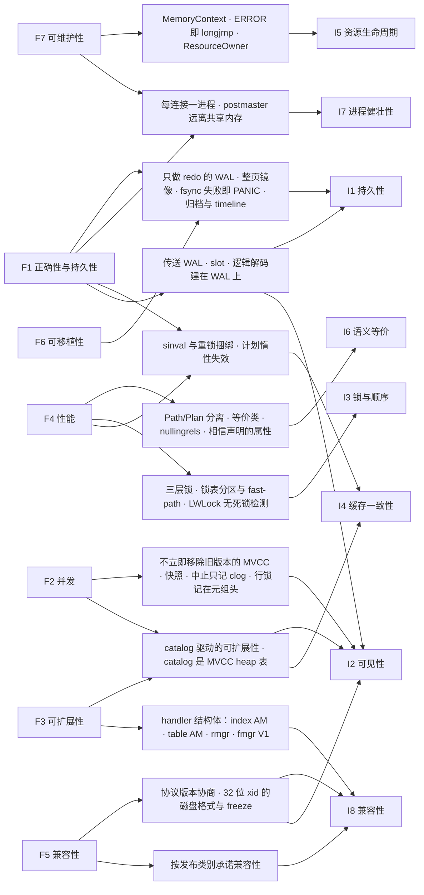

# L0：PostgreSQL core 总图

基线：worktree HEAD `4e0f8e930f3`，上游源码截至 `76c0df7381e`（2026-11-11，PG 19 开发版）。
`src/backend` 下 904 个 `.c`、93 个目录，每个文件恰好归属一个 L1 模块。
本图是带证据锚点的索引，不是权威（权威顺序见 GUIDE §0）。

## 1. 读图约定

想按因果顺序弄懂这套架构、不读代码的读者，先读 `derivation.md`（推导主线）；本文件和其余文件是它背后带证据的底稿。

**地图的形状**（GUIDE §1.4）：一条推导链 `力 × 环境前提 → 决策 → 不变量 → 模块 → 代码`。根（环境前提、力、取舍规则、基础性决策、原则）在 `principles.md`；§2 给出推导图和每条决策的下游。每个节点都要能回答"为什么存在"；回答不了的是孤儿，记在 `residuals.md`。

**读法**：§2 看一个改动顺着哪条链会撞上什么 → §3、§4 定位子系统 → §6 查不变量强制点，再读对应的 `invariants/I<n>.md`（规则与改动检查单）→
`subsystems/<n>.md` 的 L1 表定位模块 → 有卡片的模块读卡片（守什么、在什么条件下成立）→ 按证据下钻代码。

**划分依据**：文件归属按 Secret（它隐藏的那个可能变化的设计决策），不按目录。目录只是默认值，例外见 §7。

**ID 与引用**（GUIDE §10.1）：子系统 `S01`–`S12`；L1 模块 `S07.M03`；不变量族 `I1`–`I8`；决策 `D-<slug>`；
残差 `X<n>`；力 `F1`–`F7`；环境前提 `E<n>`、取舍规则 `T<n>`、原则 `R<n>`。引用写成双方括号，如 `[[S07.M03]]`。
证据写 `file:<相对仓库根的路径>:<行>`、`commit:<hash>`、`readme:<路径>#<小节>`、`url:<链接>`。

**子系统文件的结构**：YAML 头（`id` `type` `depends` `invariants`）→ Secret 与边界 → L1 表
（ID、模块、Secret、Paths、I族、卡）→ 模块卡 → 设计原因（决策）。

- 模块卡只给"拥有 I1–I8 相关状态、并且是该不变量强制点"的模块写；其余模块只占 L1 表一行。
- 卡片 7 个字段：Secret / State（`@shmem|disk|local`，`W:` 写者数即 D2）/ Inv（行尾 `{[[I2]]; D1=跨度}`）/
  Contract（适用条件 + 并发 + error、crash、cancel、standby 四项即 D3；查不到依据写"未定义"或"未核实"）/
  Depends / Derives from（由哪些决策推出；推不出写"孤儿"，即 D6）/ Evidence。
- 适用条件是抽象成立的前提（持有什么锁、是否在恢复中、隔离级别……）。条件之外的行为不由卡片保证，卡片会指出去哪里查。
- 决策行：`- D-<slug> {[[F1]]} <决策> ← 原始: …；当前: …；假设: …`。原始 = 引入时的理由（依据是引入它的提交或当时的文档）；
  当前 = 基线代码今天给出的理由；假设 = 没有锚点直接支持的推断。只有现行依据的写"原始: 未考证"。
  基础性决策在子系统文件里只留一行引用，完整记录在 `principles.md` §4。

**Paths 语法**（相对 `src/backend/`，用于机械检查覆盖）：`dir/` 该目录不递归的全部 `.c`；`dir/**` 递归；
其余是显式文件或通配。优先级：显式文件 > 通配 > 目录，跨全部子系统文件全局生效。

**I 族**（定义见 GUIDE §8）：I1 持久性 · I2 可见性 · I3 锁与顺序 · I4 缓存一致性 · I5 资源生命周期 ·
I6 语义等价 · I7 进程健壮性 · I8 兼容性。

## 2. 推导链（地图的根）

### 2.1 力、环境前提与基础性决策

定义和完整记录都在 `principles.md`：环境前提 E（§1）、力 F1–F7（§2）、取舍规则 T（§3）、基础性决策（§4）、原则 R（§5），本图不复述。各子系统文件的决策行带力标签；基础性决策在子系统文件里只留一行引用。

### 2.2 推导图



图里每个决策框是一簇决策的简称，对应的 `D-<slug>` 见 `principles.md` §4 和各子系统文件的决策行；每个不变量族由哪些决策推出、落到哪些模块，见 §6。

### 2.3 决策的下游

按"有多少张模块卡的 Derives from 引用它"排序（共 102 张卡；数据取自各子系统文件，可重算）。挂得多，说明这条决策的后果分布得广。
下表列出被 6 张及以上的卡引用的决策。

| 决策 | 卡数 | 由它推出的模块 |
|---|---|---|
| [[D-mvcc-no-overwrite]] | 16 | [[S04.M11]] [[S05.M08]] [[S05.M12]] [[S06.M04]] [[S06.M05]] [[S06.M06]] [[S06.M07]] [[S06.M08]] [[S06.M11]] [[S06.M12]] [[S06.M14]] [[S06.M15]] [[S07.M02]] [[S07.M06]] [[S07.M09]] [[S10.M05]] |
| [[D-error-longjmp-abort]] | 10 | [[S01.M05]] [[S01.M07]] [[S02.M03]] [[S02.M05]] [[S05.M01]] [[S05.M09]] [[S05.M11]] [[S07.M01]] [[S12.M03]] [[S12.M04]] |
| [[D-logical-decoding-on-wal]] | 10 | [[S06.M11]] [[S10.M01]] [[S10.M05]] [[S10.M06]] [[S10.M07]] [[S10.M08]] [[S10.M09]] [[S10.M10]] [[S10.M12]] [[S10.M13]] |
| [[D-sinval-with-locks]] | 9 | [[S02.M06]] [[S10.M15]] [[S11.M04]] [[S11.M06]] [[S11.M07]] [[S11.M08]] [[S11.M09]] [[S11.M10]] [[S11.M12]] |
| [[D-snapshot-xmin-xmax-xip]] | 8 | [[S02.M08]] [[S06.M05]] [[S07.M01]] [[S07.M02]] [[S07.M05]] [[S07.M06]] [[S07.M08]] [[S10.M10]] |
| [[D-own-buffer-cache]] | 7 | [[S08.M01]] [[S08.M02]] [[S08.M03]] [[S08.M04]] [[S09.M02]] [[S09.M03]] [[S11.M13]] |
| [[D-catalog-mvcc-heap]] | 6 | [[S10.M10]] [[S11.M01]] [[S11.M06]] [[S11.M09]] [[S11.M12]] [[S12.M16]] |
| [[D-parallel-copy-state]] | 6 | [[S01.M06]] [[S04.M05]] [[S05.M10]] [[S07.M07]] [[S11.M10]] [[S12.M06]] |
| [[D-physical-rep-ships-wal]] | 6 | [[S07.M05]] [[S07.M09]] [[S09.M05]] [[S10.M01]] [[S10.M02]] [[S10.M04]] |
| [[D-resource-owner]] | 6 | [[S02.M05]] [[S05.M01]] [[S05.M03]] [[S08.M07]] [[S12.M04]] [[S12.M16]] |
| [[D-trust-declared-properties]] | 6 | [[S04.M02]] [[S04.M03]] [[S04.M05]] [[S05.M10]] [[S05.M12]] [[S12.M05]] |
| [[D-wal-redo-only]] | 6 | [[S06.M04]] [[S07.M01]] [[S08.M13]] [[S09.M02]] [[S09.M05]] [[S12.M03]] |
| [[D-xid-wraparound-freeze]] | 6 | [[S05.M12]] [[S06.M07]] [[S06.M08]] [[S07.M02]] [[S07.M03]] [[S07.M04]] |

推导不完整的地方（D6），都记在 `residuals.md`（类型为"孤儿"的条目）：

- 2 张卡完全追不到决策：[[S06.M10]] TOAST、[[S09.M11]] 等待 LSN。
- 4 张卡只能追到力：[[S06.M16]] brin、[[S06.M18]] 序列、[[S08.M08]] unlogged 重置、[[S12.M08]] 后端状态与等待事件。
- 另有若干张卡只有部分内容能追到决策，卡片的 Derives from 行里写明了缺口。
- 共 78 条决策：子系统文件里 73 行（其中 15 行是对 `principles.md` 的引用），另有 5 条只在 `principles.md` 里。28 条的原始原因未考证；10 条没有被任何模块卡引用，它们解释的是没有写卡的模块。

## 3. 子系统总表

| ID | 子系统 | Secret（隐藏的设计决策） | Tier | 文件 | L1 | 卡 | 默认归属的目录 |
|---|---|---|---|---|---|---|---|
| [[S01]] | 进程与 IPC | 进程模型、共享内存布局与生命周期、信号与中断、进程间同步原语 | A | 48 | 8 | 7 | `main/` `postmaster/` `storage/ipc/` `port/**` `utils/init/` |
| [[S02]] | 会话与协议 | 线上协议、认证、portal 生命周期、会话内计划缓存、通知队列 | B | 30 | 8 | 5 | `libpq/` `tcop/` |
| [[S03]] | 查询前端 | SQL 文本如何变成 Query 树；视图、规则、RLS 如何以树变换展开 | S | 28 | 6 | 0 | `parser/` `rewrite/` |
| [[S04]] | 优化器 | 搜索空间、代价模型、统计信息、语义等价变换 | B | 65 | 13 | 6 | `optimizer/**` `statistics/` `partitioning/` |
| [[S05]] | 执行器 | 迭代模型、表达式求值、DML 路由与并发更新处理、触发器队列、排序与物化 | B | 88 | 14 | 8 | `executor/` `jit/**` `utils/sort/` |
| [[S06]] | 访问方法 | 元组与索引的物理组织、死版本回收与冻结、表重写 | B（heap/vacuum 为 A） | 114 | 19 | 14 | `access/{brin,common,gin,gist,hash,heap,index,nbtree,sequence,spgist,table,tablesample}/` |
| [[S07]] | 事务与并发控制 | xid 状态、快照、重锁、SSI、standby 上的事务状态 | A | 19 | 9 | 9 | `storage/lmgr/` `utils/time/` |
| [[S08]] | 存储 | 页在内存与磁盘之间怎样缓存、读写、刷盘、校验；关系文件怎样随事务创建和删除 | B | 34 | 13 | 10 | `storage/{aio,buffer,file,freespace,page,smgr,sync}/` |
| [[S09]] | WAL 与恢复 | 日志格式、插入与刷盘、redo、checkpoint、归档与备份 | A | 59 | 12 | 10 | `access/transam/` `access/rmgrdesc/` `backup/` `archive/` |
| [[S10]] | 复制 | WAL 如何离开本机、哪些保留义务压住回收（slot）、订阅端如何原子地落地 | A | 30 | 15 | 14 | `replication/**` |
| [[S11]] | catalog、缓存与 DDL | catalog 存放方式、各后端如何缓存、失效如何传播、依赖如何记录、DDL 如何分阶段执行 | A | 81 | 18 | 10 | `catalog/` `commands/` `utils/cache/` `bootstrap/` `foreign/` |
| [[S12]] | 运行时基础设施 | 进程内资源与错误的生命周期模型、函数调用约定、配置与统计、内建类型 | S（9 个模块写卡） | 308 | 17 | 9 | `utils/{mmgr,error,resowner,fmgr,misc,activity,adt,hash}/` `utils/mb/**` `nodes/` `lib/` `regex/` `snowball/**` `tsearch/` `storage/large_object/` |

合计 904 个文件、152 个 L1 模块、102 张卡。

## 4. 子系统卡

每张卡：L1 模块（★ = 有模块卡）/ State / 最关键的 1–3 条不变量 / Depends（"uses" 关系）/ Why（基础性设计原因，证据在所引决策处）。

### S01 进程与 IPC（A）
- L1: M01 postmaster 监督与子进程启动★ · M02 辅助进程与 bgworker 框架★ · M03 共享内存与 DSM★ · M04 信号、中断、latch 与等待★ · M05 PGPROC 与同步原语★ · M06 并行基础设施★ · M07 后端主循环与初始化★ · M08 Windows 适配
- State: postmaster 的子进程表与状态机 @local；PMChildFlags、ProcSignalSlot、Latch、bgworker 槽、主段与 ShmemIndex、DSM 控制段、PGPROC、LWLock 状态 @shmem；各进程的中断标志、`held_lwlocks[]`、退出回调表 @local
- Inv: (1) 按设计约定 postmaster 不取锁、避免触碰共享内存；子进程异常退出即视为崩溃：SIGQUIT 全体子进程，等全部退出后重建共享内存 {[[I7]]} 〔file:src/backend/postmaster/postmaster.c:15-22,2625-2632,2661-2668,3258-3283; file:src/backend/storage/ipc/pmsignal.c:95-99〕
- Inv: (2) 持有 LWLock 期间 cancel/die 被挂起，出错或退出时 `LWLockReleaseAll` 全部释放；多把锁的加锁顺序只是约定，没有机械检查（见 [[X6]]） {[[I3]] [[I5]]} 〔file:src/backend/storage/lmgr/lwlock.c:1185-1189,1866-1876; file:src/backend/storage/lmgr/README:20-30,242-244〕
- Inv: (3) 中断只在 holdoff 计数为 0 且不在临界区时被接受；顶层 sigsetjmp 是 ERROR 的最终落点；收到 SIGQUIT 时 `_exit(2)`，不跑任何回调 {[[I5]] [[I7]]} 〔file:src/backend/tcop/postgres.c:3095-3110,3456-3471,4549-4578〕
- Depends: [[S02]] [[S07]] [[S09]] [[S11]] [[S12]]
- Derives from: [[D-process-per-connection]] 每连接一进程，认证在子进程里做；[[D-postmaster-no-shmem]] postmaster 远离共享内存，子进程异常即整体重置；[[D-signal-flag-latch]] 信号只置标志，处理延后到 CHECK_FOR_INTERRUPTS；[[D-lock-tiers]] 锁分 spinlock、LWLock、重锁三层

### S02 会话与协议（B）
- L1: M01 连接启动与认证★ · M02 传输安全 · M03 消息收发★ · M04 结果目的地 · M05 portal 与执行驱动★ · M06 计划缓存与预备语句★ · M07 会话状态重置 · M08 LISTEN/NOTIFY★
- State: 几乎全部进程私有（收发缓冲、portal 表、缓存的计划、预备语句表、函数缓存）@local；唯一共享状态是 NOTIFY：队列控制与通道表 @shmem，`pg_notify/` 队列页 @disk（不写 WAL）
- Inv: (1) 计划缓存由 sinval 驱动失效、下次使用时重做；使用前先加锁再复查有效性，覆盖"失效消息在加锁前到达"的竞态；前提是需要重规划的表修改都会产生 relcache 失效，这一点没有机械检查（见 [[X10]]） {[[I4]]} 〔file:src/backend/utils/cache/plancache.c:14,746〕
- Inv: (2) 出站消息只能整条发出；读消息途中出错即失去同步，连接以 FATAL 终止 {[[I8]]} 〔file:src/backend/libpq/pqcomm.c:11; file:src/backend/tcop/postgres.c:4666〕
- Inv: (3) NOTIFY 写者从提交前到提交后持同一把重锁，所以队列项按提交顺序排列 {[[I2]] [[I3]]} 〔file:src/backend/commands/async.c:1280〕
- Depends: [[S01]] [[S03]] [[S04]] [[S05]] [[S07]] [[S11]] [[S12]]
- Derives from: [[D-plancache-lazy-inval]] 失效只做标记，下次使用时惰性重做；[[D-proto-whole-message]] 消息整条发送，ERROR 不会让通道停在半条消息上；[[D-notify-slru-queue]] 通知走单一 SLRU 队列，不写 WAL、重启即清空

### S03 查询前端（S）
- L1: M01 原始解析 · M02 语义分析 · M03 utility 语句变换 · M04 规则定义 · M05 查询改写 · M06 行级安全
- State: 只有每语句的 Query 树 @local（单写者）；pg_rewrite 行由 M04 写。本子系统给 I3/I4/I6 提供输入，但不是任何一族的强制点，所以没有模块卡
- Inv: (1) 分析时对引用的每个关系取锁并把锁模式记入 RTE；早于当前命令产生的树必须先经 `AcquireRewriteLocks` 重新取锁，再做任何改写决定 {[[I3]]} 〔file:src/backend/parser/parse_relation.c:1535-1544; file:src/backend/rewrite/rewriteHandler.c:103-131,175-197; commit:ba42002461a〕
- Inv: (2) 分析结果依赖 catalog 状态、search_path 和 RLS 环境，任一变化都由计划缓存重做分析或改写 {[[I4]]} 〔file:src/backend/utils/cache/plancache.c:14-20; file:src/backend/rewrite/rowsecurity.c:136-148〕
- Inv: (3) 视图与 RLS 都以改写期的 Query 树变换实现，策略条件前置到 securityQuals {[[I6]]} 〔file:src/backend/rewrite/rowsecurity.c:13-23; commit:491c029dbc4〕
- Depends: [[S07]] [[S11]] [[S12]]
- Derives from: [[D-raw-parse-no-catalog]] 原始解析不访问 catalog，因为它必须能在已中止的事务里运行；[[D-utility-late-analysis]] utility 语句推迟到执行时才分析；[[D-rewrite-relock]] 改写前对早于当前命令产生的树重新取锁

### S04 优化器（B）
- L1: M01 顶层与上层规划 · M02 预处理与连接树变换★ · M03 路径生成与竞争★ · M04 GEQO · M05 语义推理★ · M06 代价与选择率 · M07 计划生成与引用修正 · M08 规划器数据结构 · M09 catalog 接口★ · M10 继承与分区 · M11 统计采集★ · M12 扩展统计 · M13 统计导入★
- State: 规划期数据（PlannerInfo、RelOptInfo、PlannerGlobal）@local；pg_statistic、pg_statistic_ext_data @disk（W: ANALYZE 与统计导入）；pg_class 的统计列 @disk（与 [[S06]] 共写）
- Inv: (1) `equal()` 的两个 Var 是同一个值；varnullingrels 记录哪些外连接可能把它置空 {[[I6]]} 〔commit:2489d76c490; file:src/backend/optimizer/README:343〕
- Inv: (2) 计划依赖的每个关系和对象都记入 relationOids/invalItems，供计划缓存失效；catalog 事实在调用者已持有的表锁下读取 {[[I4]] [[I3]]} 〔file:src/backend/optimizer/plan/setrefs.c:282; file:src/backend/optimizer/util/plancat.c:131〕
- Inv: (3) 并行安全来自 proparallel 标注，规划器不验证标注是否属实 {[[I6]]} 〔file:src/backend/optimizer/plan/planner.c:455; file:src/backend/optimizer/util/clauses.c:812〕
- Depends: [[S03]] [[S06]] [[S07]] [[S11]] [[S12]]
- Derives from: [[D-path-plan-split]] Path 只带规划所需信息，选定后才转成 Plan；[[D-equivalence-class]] 用等价类表示传递相等；[[D-var-nullingrels]] Var 携带可置空它的外连接集合

### S05 执行器（B）
- L1: M01 执行生命周期与节点分发★ · M02 元组槽 · M03 表达式求值与 JIT★ · M04 扫描节点 · M05 连接节点★ · M06 聚合、窗口与集合运算 · M07 物化与控制节点 · M08 DML、行锁与分区路由★ · M09 触发器与延迟约束★ · M10 并行执行★ · M11 SPI 与 SQL 函数★ · M12 COPY★ · M13 EXPLAIN 与执行统计 · M14 排序与元组存储
- State: 全部后端本地：EState 与平行的 PlanState 树、EPQState、AFTER 触发器队列、tuplesort/tuplestore 及其临时文件 @local；唯一共享状态是并行查询的 DSM @shmem
- Inv: (1) READ COMMITTED 下目标行被并发更新时，锁住最新版本并用 EvalPlanQual 对它重跑条件；事务级快照下改报序列化失败 {[[I2]]} 〔file:src/backend/executor/nodeModifyTable.c:1738-1773; file:src/backend/executor/README:355-384〕
- Inv: (2) 出错路径不调用 ExecutorEnd：内存随 per-query 或 portal 上下文释放，关系与 buffer pin 随 ResourceOwner 释放 {[[I5]]} 〔file:src/backend/executor/execMain.c:15-17; file:src/backend/utils/resowner/README:6-12〕
- Inv: (3) 延迟触发器事件在提交前反复触发直到清空；子事务中止截掉它加入的事件，事务结束全部丢弃 {[[I5]]} 〔file:src/backend/commands/trigger.c:3863-3866,5355-5365,5382,5538〕
- Depends: [[S01]] [[S02]] [[S04]] [[S06]] [[S07]] [[S08]] [[S11]] [[S12]]
- Derives from: [[D-exec-pull-iterator]] 按需拉取的迭代器；[[D-plan-readonly-planstate]] Plan 树只读，可变状态放在平行的 PlanState 树，计划才能缓存复用；[[D-expr-linear-steps]] 表达式编译成线性步骤，解释与 JIT 共用；[[D-evalplanqual]]

### S06 访问方法（B；heap 与 vacuum 为 A）
- L1: M01 table AM 接口 · M02 index AM 接口 · M03 元组表示 · M04 heap 核心★ · M05 heap 可见性★ · M06 pruning 与 HOT★ · M07 vacuum 与 freeze★ · M08 visibility map★ · M09 heap redo · M10 TOAST★ · M11 表重写★ · M12 nbtree★ · M13 gin★ · M14 gist★ · M15 hash★ · M16 brin★ · M17 spgist★ · M18 序列★ · M19 tablesample
- State: heap 页（元组头、行指针状态、PD_ALL_VISIBLE、hint bit）、VM fork、各 AM 的索引页、序列页 @disk；relfrozenxid/relminmxid/datfrozenxid @disk；AutoVacuumShmem、syncscan 位置 @shmem；死 TID 集合 @local 或 DSA
- Inv: (1) 对需要写 WAL 的关系，改页面按 WAL 编码步骤进行：加锁、进临界区、修改、MarkBufferDirty、XLogInsert、PageSetLSN {[[I1]]; D1=3: [[S06]], [[S08]], [[S09]]} 〔file:src/backend/access/transam/README:437-458; file:src/backend/access/heap/heapam.c:2067-2185〕
- Inv: (2) 表里没有早于 relfrozenxid 的未冻结 xid；freeze 只动非 DEAD 元组，不改变可见性 {[[I2]]; D1=2: [[S06]], [[S07]]} 〔file:src/backend/access/heap/vacuumlazy.c:775-797,926-935; file:src/include/access/htup_details.h:347-352〕
- Inv: (3) VM 位被设置即条件为真；清位与 heap 修改在同一临界区、同一条 WAL 记录里 {[[I1]] [[I2]]} 〔file:src/backend/access/heap/visibilitymap.c:33-73; file:src/backend/access/heap/heapam.c:2060-2076,2178〕
- Depends: [[S01]] [[S04]] [[S07]] [[S08]] [[S09]] [[S10]] [[S11]] [[S12]]
- Derives from: [[D-mvcc-no-overwrite]] UPDATE/DELETE 不立即移除行的旧版本，由 VACUUM 回收，读写互不阻塞；[[D-hot]] 同页且不改索引列的更新不建新索引项；[[D-idx-am]] [[D-table-am]] AM 能力由 handler 返回的 C 结构体表达；[[D-row-lock-in-tuple-header]] 行锁记在元组头，多个持有者用 MultiXactId

### S07 事务与并发控制（A）
- L1: M01 事务状态机与两阶段提交★ · M02 xid 空间与提交状态★ · M03 SLRU★ · M04 multixact★ · M05 运行中事务集合★ · M06 快照管理★ · M07 重锁管理器★ · M08 SSI★ · M09 standby 事务状态与冲突★
- State: nextXid 与回卷界限、各进程 xid 与 subxid 状态、latestCompletedXid、KnownAssignedXids、锁表（分区哈希、fast-path 槽、强锁计数）、SSI 结构、MultiXactState、TwoPhaseState @shmem；pg_xact、pg_subtrans、pg_commit_ts、pg_multixact、pg_serial、pg_twophase @disk；事务状态栈、快照、combo CID @local
- Inv: (1) 有 xid 的事务只能在排他持有 ProcArrayLock 时离开运行集合，取快照时共享持有它；提交顺序是 WAL → clog → ProcArray → sinval → 释放锁 {[[I2]]} 〔file:src/backend/access/transam/README:241-263; file:src/backend/access/transam/xact.c:1488,1548,1560,2446,2490,2494〕
- Inv: (2) xid 按模 2^32 比较，wrapLimit = 最老 datfrozenxid + 2^31；越过 xidStopLimit 即拒绝分配新 xid，所以 freeze 必须赶在 xid 落后 2^31 之前完成 {[[I2]] [[I8]]; D1=3: [[S07]], [[S06]], [[S11]]} 〔file:src/include/access/transam.h:266-271; file:src/backend/access/transam/varsup.c:384,400; file:src/backend/commands/vacuum.c:1985-2009〕
- Inv: (3) fast-path 只在强锁计数为零时可用；强锁申请者先加计数，再把匹配的 fast-path 锁迁入主表；跨分区按分区号顺序加锁，仅为约定（见 [[X41]]） {[[I3]]} 〔file:src/backend/storage/lmgr/README:239-248,286-320〕
- Depends: [[S01]] [[S06]] [[S08]] [[S09]] [[S10]] [[S11]] [[S12]]
- Derives from: [[D-abort-by-clog]] 中止只在 clog 记一笔且不刷 WAL（"因此不需要 undo"在源码文档里没有明文，按假设记录）；[[D-snapshot-xmin-xmax-xip]] 快照是 (xmin, xmax, xip[])；[[D-ssi]] 可串行化用 SSI 而不是严格两阶段锁；[[D-lock-partition-fastpath]] 锁表分区加 fast-path；[[D-row-lock-in-tuple-header]] 行锁记在元组头，多个持有者用 MultiXactId；[[D-lock-tiers]] 锁分 spinlock、LWLock、重锁三层

### S08 存储（B）
- L1: M01 共享 buffer 管理★ · M02 本地 buffer★ · M03 smgr 与 md★ · M04 fsync 请求队列★ · M05 AIO 核心★ · M06 read stream · M07 虚拟 fd 与临时文件★ · M08 unlogged 重置★ · M09 FSM · M10 页面格式与校验和★ · M11 后台回写 · M12 校验和在线开关★ · M13 关系文件的事务性生命周期★
- State: 共享 buffer 池（描述符、页、映射哈希、clock hand）、AIO 句柄 @shmem；checkpointer 的待 fsync 表与待 unlink 表、各后端的 pendingDeletes 与 pendingSyncHash @local；页头格式与 pd_checksum @disk
- Inv: (1) 持久页写出前必须先 `XLogFlush` 到该页 LSN {[[I1]]; D1=2: [[S08]], [[S09]]} 〔file:src/backend/storage/buffer/bufmgr.c:4590〕
- Inv: (2) 数据文件 fsync 失败一律 PANIC，除非开了 data_sync_retry {[[I1]]} 〔file:src/backend/storage/file/fd.c:3970-3990; commit:9ccdd7f66e3〕
- Inv: (3) 访问页要先 pin 再取内容锁；物理删除元组需要 cleanup lock {[[I3]]} 〔file:src/backend/storage/buffer/README:12-26,83-92〕
- Depends: [[S01]] [[S06]] [[S07]] [[S09]] [[S11]] [[S12]]
- Derives from: [[D-clock-sweep]] 替换用 clock sweep，避开全局链表争用；[[D-page-checksum]] 整页镜像只防撕裂页，校验和检测 IO 系统造成的损坏；[[D-fsync-fail-panic]]；[[D-smgr-layer]] 隐藏"一个关系 = 多 fork × 多段文件"；[[D-lock-tiers]] buffer 头用 spinlock、页内容用 LWLock；[[D-compat-by-release-class]] 页面格式只在大版本改

### S09 WAL 与恢复（A）
- L1: M01 WAL 记录构造★ · M02 WAL 插入、刷盘、段文件与控制文件★ · M03 checkpoint/restartpoint 驱动★ · M04 WAL 读取与解码 · M05 恢复驱动★ · M06 rmgr 注册、描述与页掩码★ · M07 timeline★ · M08 归档★ · M09 基础备份与增量备份★ · M10 WAL 摘要★ · M11 等待 LSN★ · M12 SQL 接口
- State: XLogCtl（插入位置、redo 点、write/flush 位置、TLI、恢复状态）、XLogRecoveryCtl、CheckpointerShmem、pg_control 的内存映像 @shmem；pg_control、`pg_wal/` 段文件、`*.history`、`archive_status/`、`pg_wal/summaries` @disk
- Inv: (1) WAL 先于数据：页不会早于它的 WAL 落盘，FlushBuffer 先 XLogFlush 到页 LSN {[[I1]]; D1=3: [[S09]], [[S08]], [[S06]]} 〔file:src/backend/access/transam/README:407-418; file:src/backend/storage/buffer/bufmgr.c:4573-4591〕
- Inv: (2) checkpoint redo 点之后对页的首次修改必须带整页镜像；取得插入锁后要复查 redo 点 {[[I1]]} 〔file:src/backend/access/transam/xloginsert.c:698; file:src/backend/access/transam/xlog.c:930-948〕
- Inv: (3) redo 幂等：记录 LSN ≤ 页 LSN 即跳过；到达 minRecoveryPoint（及备份结束点）且 standby 快照就绪后才允许只读连接 {[[I1]] [[I2]]} 〔file:src/backend/access/transam/xlogutils.c:444-445; file:src/backend/access/transam/xlogrecovery.c:2226-2269〕
- Depends: [[S01]] [[S06]] [[S07]] [[S08]] [[S10]] [[S12]]
- Derives from: [[D-wal-redo-only]] 重放到 WAL 末尾即无半完成事务，只做 redo（"不做 undo"是由原文推出的，按假设记录）；[[D-wal-self-describing]] 记录格式自描述，外部工具不必理解各 rmgr；[[D-full-page-writes]] 不假定页写是原子的；[[D-custom-rmgr]] 资源管理器可由扩展注册；[[D-wal-archive-pitr]] WAL 可归档并用于时间点恢复，归档恢复结束开新 timeline

### S10 复制（A）
- L1: M01 walsender★ · M02 walreceiver★ · M03 复制连接传输 · M04 同步复制★ · M05 复制槽★ · M06 槽同步★ · M07 逻辑解码框架★ · M08 逻辑 WAL 级别控制★ · M09 reorder buffer★ · M10 历史快照构建★ · M11 复制源★ · M12 输出协议与 pgoutput★ · M13 apply 端★ · M14 初始同步★ · M15 发布订阅定义★
- State: slot 数组、WalSndCtl（各 walsender 进度、同步复制队列）、WalRcvData、origin 进度、worker 数组 @shmem；`pg_replslot/*/state`、`pg_logical/replorigin_checkpoint`、`pg_logical/snapshots`、reorder buffer 溢出文件、发布订阅与 origin 的 catalog @disk
- Inv: (1) 有效 slot 的最小 restart_lsn 之前的 WAL 不被回收，slot 的 xmin/catalog_xmin 压住 vacuum 视界；逻辑 slot 先把新值落盘再推进生效值 {[[I1]] [[I2]]; D1=4: [[S10]], [[S09]], [[S07]], [[S06]]} 〔file:src/backend/replication/slot.c:1232-1368; file:src/backend/replication/logical/logical.c:1963-2035〕
- Inv: (2) 同步复制下提交要等同步备库确认才返回；等待被取消或后端被终止时，客户端收到 WARNING：已本地提交但可能未复制 {[[I1]]; D1=2: [[S10]], [[S07]]} 〔file:src/backend/replication/syncrep.c:289-335; file:src/backend/access/transam/xact.c:1599-1609〕
- Inv: (3) apply 端的进度写进本地提交记录，与提交原子地推进，崩溃后由 redo 精确恢复 {[[I1]]; D1=3: [[S10]], [[S07]], [[S09]]} 〔file:src/backend/replication/logical/origin.c:26-36; file:src/backend/access/transam/xact.c:1496-1499,6297-6301〕
- Depends: [[S01]] [[S02]] [[S05]] [[S06]] [[S07]] [[S08]] [[S09]] [[S11]] [[S12]]
- Derives from: [[D-replication-slot]] 用崩溃安全的 slot 阻止过早回收 WAL 与过早剪枝，不放 catalog 以便在 standby 上创建；[[D-logical-decoding-on-wal]] 逻辑解码建在 WAL 上；[[D-origin-progress-in-commit]]；[[D-syncrep-primary-decides]] 同步复制的决策只在主库

### S11 catalog、缓存与 DDL（A）
- L1: M01 catalog 物理操作★ · M02 各 catalog 操作例程 · M03 依赖与对象地址★ · M04 命名空间与搜索路径★ · M05 权限与对象访问钩子 · M06 catcache/syscache★ · M07 relcache 及附属★ · M08 relation mapper★ · M09 失效传播★ · M10 派生缓存★ · M11 utility 分发与事件触发器 · M12 表与索引 DDL★ · M13 数据库与表空间★ · M14 扩展 · M15 其余对象 DDL · M16 引导 · M17 FDW 目录接口 · M18 reloptions
- State: catalog 行（普通 heap 表）、pg_depend/pg_shdepend 依赖图、`pg_filenode.map`、`pg_internal.init` @disk；SI 环形队列与各后端 ProcState @shmem；各后端的 catcache、relcache、派生缓存 @local
- Inv: (1) 提交时失效消息在提交记录之后、释放重锁之前广播；之后取得该锁的后端在 `LockRelationOid` 里接收失效，所以持有锁即已看到变更；队列溢出时落后者被 reset，丢弃全部缓存；例外：已持有所需锁时不再接收失效（见 [[X72]]） {[[I4]] [[I3]]; D1=3: [[S11]], [[S07]], [[S06]]} 〔file:src/backend/access/transam/xact.c:2484; file:src/backend/storage/lmgr/lmgr.c:117; file:src/backend/storage/ipc/sinvaladt.c:49; commit:568d4138c64〕
- Inv: (2) DDL 是事务性的：catalog 行靠 MVCC 回滚，物理文件靠 [[S08]] 的 pendingDeletes {[[I1]] [[I2]]; D1=2: [[S11]], [[S08]]} 〔file:src/backend/commands/tablecmds.c:4590; file:src/backend/catalog/heap.c:2161; file:src/backend/catalog/storage.c:77〕
- Inv: (3) DROP 对每个依赖对象先加锁再复查，然后才递归；记录依赖时对被引用对象取 AccessShareLock，并发 CREATE/DROP 不会留下悬挂引用 {[[I3]]} 〔file:src/backend/catalog/dependency.c:849; file:src/backend/catalog/pg_depend.c:736; commit:2fbb21170e9〕
- Depends: [[S01]] [[S05]] [[S06]] [[S07]] [[S08]] [[S09]] [[S10]] [[S12]]
- Derives from: [[D-catalog-driven-extensibility]] 类型、函数、AM 都存在用户可改的 catalog 里；[[D-catalog-mvcc-heap]] catalog 是普通 heap 表、用 MVCC 快照扫描；[[D-sinval-with-locks]] 缓存一致性走 sinval 共享队列，并与重锁捆绑；[[D-relmapper]]

### S12 运行时基础设施（S；9 个模块写卡）
- L1: M01 内存上下文★ · M02 动态共享内存分配器★ · M03 错误报告与日志★ · M04 ResourceOwner★ · M05 函数管理器与动态加载★ · M06 GUC★ · M07 累积统计★ · M08 后端状态与等待事件★ · M09 节点基础设施 · M10 通用数据结构 · M11 内建数据类型与函数 · M12 编码转换 · M13 正则 · M14 词干 · M15 全文检索 · M16 大对象★ · M17 杂项
- State: 多为进程本地：内存上下文树、错误栈、ResourceOwner 树、已加载的库、GUC 值及其栈 @local；统计表、各后端状态槽、DSA 区、injection point 注册表 @shmem；统计文件 @disk（关机时写出）
- Inv: (1) 临界区内任何 ERROR 及以上都升级为 PANIC；前提是调用方正确维护临界区计数（见 [[X81]]） {[[I5]]} 〔file:src/backend/utils/error/elog.c:375〕
- Inv: (2) ResourceOwner 分三阶段释放（锁之前、锁、锁之后），每阶段遍历整棵树后才进入下一阶段，子先于父；子事务提交时锁转给父而不释放 {[[I5]]; D1=3: [[S12]], [[S07]], [[S02]]} 〔file:src/backend/utils/resowner/README:123; file:src/backend/utils/resowner/resowner.c:696,793〕
- Inv: (3) 删除或 reset 一个内存上下文即释放其全部后代；ErrorContext 始终保留 8K，保证内存耗尽时仍能报错 {[[I5]]} 〔file:src/backend/utils/mmgr/README:110; file:src/backend/utils/mmgr/mcxt.c:380〕
- Depends: [[S01]] [[S02]] [[S05]] [[S06]] [[S07]] [[S08]] [[S09]] [[S11]]
- Derives from: [[D-memory-context]] 按上下文子树整体释放，不逐块 free；[[D-error-longjmp-abort]] ERROR 是 longjmp，清理集中到事务中止；[[D-resource-owner]] 管 pin、锁等非内存资源；[[D-fmgr-v1]]；[[D-node-codegen]] 节点支持函数由结构体定义生成；[[D-compat-by-release-class]] 小版本不改 ABI，扩展库加载时校验

## 5. 依赖关系

"uses" 图不是分层的：按各文件 YAML 头的 `depends`，12 个子系统之间有 80 条边，其中 56 条成对出现（28 对双向依赖）。
下面的层次只是阅读顺序，不是对代码的断言（假设）：

```
会话        S02
查询处理    S03 → S04 → S05
元数据      S11
数据组织    S06
持久层      S07 · S08 · S09            旁路：S10（读 S09 的 WAL、S07 的事务状态、S11 的 catalog；apply 经 S05 写入）
基础        S01 · S12
```

下层调用上层的边都经由回调、函数表或钩子，典型的有：

- [[S09]] → [[S06]]：恢复经 rmgr 表调用各 AM 的 redo 例程。
- [[S07]] → [[S10]]：提交路径里等待同步复制确认，并把 origin 进度写进提交记录。
- [[S12]] → [[S07]] [[S08]]：ResourceOwner 释放重锁、buffer pin、AIO 句柄。
- [[S08]] → [[S06]]：关系截断时处理 visibility map。
- [[S06]] → [[S10]]：REPACK 并发模式用逻辑解码捕获变更；[[S06]] → [[S04]]：vacuum 分派 ANALYZE。
- [[S01]] → [[S02]] [[S11]]：后端主循环分派协议消息；后端初始化读 catalog。

## 6. 不变量族的强制点

每一族的跨模块规则、协议、改动检查单和历史 bug 类别在 `invariants/I<n>.md`；判断一个改动会破坏什么，先读那里。下表取自各模块卡所在 L1 行的 I族 标注（只列有卡的模块）。"推出它的决策"一栏对应 GUIDE P.4 第 4 条（可推导），归类是地图作者的判断，证据在所引决策处。改动落在哪个模块，就先看它在哪几行出现。

| 族 | 推出它的决策 | 强制点（有卡模块） |
|---|---|---|
| [[I1]] 持久性 | [[D-wal-redo-only]] [[D-full-page-writes]] [[D-hint-wal-checksum]] [[D-fsync-fail-panic]] [[D-replication-slot]] [[D-origin-progress-in-commit]] [[D-relmapper]] [[D-wal-archive-pitr]] | S06: M04 M05 M06 M08 M10 M11 M12 M13 M14 M15 M16 M17 M18 · S07: M01 M02 M03 M04 · S08: M01 M03 M04 M07 M08 M10 M12 M13 · S09: M01 M02 M03 M05 M06 M07 M08 M09 M10 · S10: M01 M02 M04 M05 M06 M07 M08 M11 M12 M13 M14 M15 · S11: M01 M08 M13 |
| [[I2]] 可见性 | [[D-mvcc-no-overwrite]] [[D-snapshot-xmin-xmax-xip]] [[D-abort-by-clog]] [[D-xid-wraparound-freeze]] [[D-ssi]] [[D-evalplanqual]] [[D-catalog-mvcc-heap]] [[D-row-lock-in-tuple-header]] [[D-logical-decoding-on-wal]] | S02: M08 · S04: M11 · S05: M08 M09 M12 · S06: M04 M05 M06 M07 M08 M11 M12 · S07: M01 M02 M03 M04 M05 M06 M08 M09 · S09: M05 · S10: M01 M02 M05 M06 M07 M08 M09 M10 M13 · S11: M01 M12 · S12: M16 |
| [[I3]] 锁与顺序 | [[D-lock-partition-fastpath]] [[D-deadlock-optimistic-wait]] [[D-lwlock-no-deadlock-detect]] [[D-analyze-takes-locks]] [[D-rewrite-relock]] [[D-lock-tiers]] [[D-row-lock-in-tuple-header]] | S01: M05 · S02: M08 · S04: M09 M11 M13 · S05: M01 M08 M10 · S06: M04 M06 M07 M11 M12 M13 M14 M15 M17 · S07: M01 M03 M07 M08 M09 · S08: M01 M02 M05 · S09: M02 · S10: M04 M05 M06 M07 M11 M13 · S11: M03 M04 M09 M12 M13 · S12: M02 M07 M08 |
| [[I4]] 缓存一致性 | [[D-sinval-with-locks]] [[D-plancache-lazy-inval]] [[D-utility-late-analysis]] [[D-rls-env-replan]] [[D-catalog-driven-extensibility]] [[D-catalog-mvcc-heap]] | S01: M04 · S02: M06 · S04: M09 · S08: M03 · S10: M09 M12 M13 M15 · S11: M01 M04 M06 M07 M08 M09 M10 M12 |
| [[I5]] 资源生命周期 | [[D-memory-context]] [[D-error-longjmp-abort]] [[D-resource-owner]] [[D-signal-flag-latch]] | S01: M03 M04 M05 M06 M07 · S02: M03 M05 · S05: M01 M03 M09 M10 M11 · S07: M01 · S08: M01 M02 M03 M05 M07 M13 · S09: M01 M11 · S10: M09 · S11: M04 M06 M07 · S12: M01 M02 M03 M04 M06 M07 M08 M16 |
| [[I6]] 语义等价 | [[D-var-nullingrels]] [[D-equivalence-class]] [[D-view-rls-as-rewrite]] [[D-parallel-copy-state]] [[D-path-plan-split]] [[D-trust-declared-properties]] | S01: M06 · S02: M06 · S04: M02 M03 M05 · S05: M03 M05 M10 M12 · S11: M10 · S12: M06（无卡但有标注：S03: M02 M05 M06 · S04: M01 M07 M10 · S05: M06 M07 · S12: M09 M11） |
| [[I7]] 进程健壮性 | [[D-postmaster-no-shmem]] [[D-process-per-connection]] | S01: M01 M02 M03 M07 · S02: M01 · S06: M07 · S09: M02 M03 M05 · S10: M01 · S12: M03 |
| [[I8]] 兼容性 | [[D-fmgr-v1]] [[D-idx-am]] [[D-table-am]] [[D-proto-minor-negotiation]] [[D-wal-self-describing]] [[D-xid-wraparound-freeze]] [[D-compat-by-release-class]] | S02: M01 M03 · S04: M13 · S06: M10 · S07: M02 · S08: M03 M10 M12 · S09: M01 M02 M06 · S10: M05 M10 M12 M13 · S12: M05（无卡但有标注：S02: M02 M04 · S03: M01 · S04: M12 · S05: M02 M13 · S06: M01 M02 M03 · S09: M04 · S10: M03 · S11: M02 M14 M16 M18 · S12: M09 M11） |

## 7. 归属规则

目录默认归属见 §3 的表。各 AM 的 `*xlog.c`（redo 例程）留在 AM 所在模块（S06），不归 S09：redo 必须懂页面格式。

### 7.1 例外（文件的 Secret 与所在目录不一致）

GUIDE §7 的表只列主要目录，完整的归属以本节和各子系统 L1 表的 Paths 列为准。

| 文件 | 归属 | 它隐藏的是什么 |
|---|---|---|
| `tcop/postgres.c` | S01 | 后端主循环、中断处理点、错误恢复落点（消息处理函数也在此文件，逻辑上属 S02，见 [[X3]]） |
| `access/transam/parallel.c` `access/common/session.c` | S01 | worker 如何继承 leader 的进程级状态 |
| `storage/lmgr/{lwlock,s_lock,condition_variable,proc}.c` | S01 | 进程间同步原语与 PGPROC（重锁管理器留在 S07） |
| `utils/misc/{timeout,ps_status}.c` `libpq/pqsignal.c` | S01 | 基于信号的超时、进程标题、信号屏蔽集 |
| `utils/cache/{plancache,funccache}.c` `utils/mmgr/portalmem.c` | S02 | 会话内缓存的计划与 portal 生命周期 |
| `commands/{prepare,portalcmds,discard,async}.c` | S02 | 会话级对象：预备语句、游标、LISTEN/NOTIFY |
| `access/common/{printtup,printsimple}.c` | S02 | 元组到线上格式 |
| `utils/misc/rls.c` | S03 | RLS 是否生效的判定 |
| `commands/analyze.c` `utils/misc/sampling.c` `utils/adt/selfuncs.c` | S04 | 统计信息的采集与选择率估计 |
| `commands/{trigger,constraint}.c` | S05 | 触发器触发队列与延迟约束 |
| `commands/copy*.c` `commands/explain*.c` `utils/misc/queryenvironment.c` | S05 | 批量装载的 DML 路径；计划与执行统计的呈现；临时命名关系 |
| `commands/{vacuum,vacuumparallel}.c` `postmaster/autovacuum.c` | S06 | vacuum 的驱动与调度 |
| `commands/{repack,repack_worker}.c` `replication/pgrepack/` | S06 | 表重写及其并发变更捕获 |
| `commands/{sequence,sequence_xlog}.c` | S06 | 序列的物理状态与非事务性推进 |
| `access/transam/{xact,clog,commit_ts,multixact,slru,subtrans,transam,twophase,twophase_rmgr,varsup}.c` | S07 | 事务状态机与 xid 状态存储 |
| `storage/ipc/{procarray,standby}.c` `commands/lockcmds.c` | S07 | 运行中事务集合；standby 上的事务状态与冲突；LOCK TABLE |
| `postmaster/{bgwriter,datachecksum_state}.c` | S08 | 脏页回写策略；页校验和状态迁移 |
| `catalog/storage.c` | S08 | 关系物理文件的事务性生命周期 |
| `postmaster/{checkpointer,walwriter,startup,pgarch,walsummarizer}.c` | S09 | checkpoint、WAL 刷盘、恢复、归档、WAL 摘要的驱动进程 |
| `access/common/bufmask.c` `utils/misc/pg_controldata.c` `commands/wait.c` | S09 | WAL 一致性检查的页掩码；控制文件视图；等待 LSN |
| `commands/{publicationcmds,subscriptioncmds}.c` `catalog/{pg_publication,pg_subscription}.c` | S10 | 发布订阅的定义 |
| `storage/ipc/{sinval,sinvaladt}.c` | S11 | 失效消息的跨后端传输 |
| `tcop/utility.c` | S11 | utility 语句分发 |
| `access/common/reloptions.c` `partitioning/partdesc.c` `utils/misc/superuser.c` | S11 | reloptions 解析；分区描述符缓存；超级用户判定 |
| `libpq/be-fsstubs.c` `commands/variable.c` | S12 | 大对象接口；特殊 GUC 的 check/assign 钩子 |
